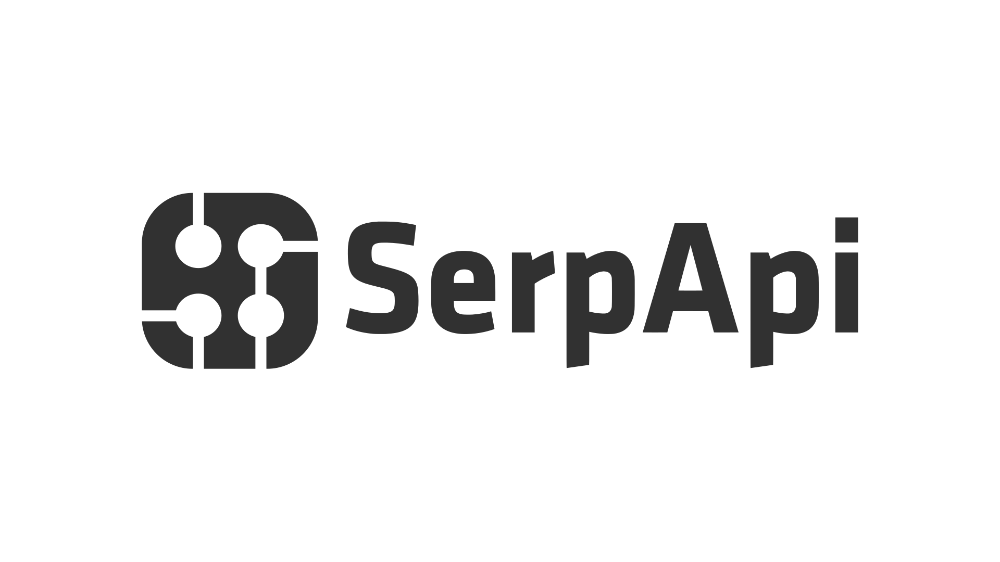

# Design Patterns Implemented in Java

## Images

<!-- ALL-CONTRIBUTORS-BADGE:START - Do not remove or modify this section -->

<!-- ALL-CONTRIBUTORS-BADGE:END -->

 

Read in different language : [**zh**](localization/zh/README.md),  [**zh-TW**](localization/zh-TW/README.md)
,[**ko**](localization/ko/README.md), [**fr**](localization/fr/README.md), [**tr**](localization/tr/README.md), [**ar**](localization/ar/README.md), [**es**](localization/es/README.md), [**pt**](localization/pt/README.md), [**id**](localization/id/README.md), [**ru**](localization/ru/README.md), [**de**](localization/de/README.md), [**ja**](localization/ja/README.md), [**vi**](localization/vi/README.md), [**bn**](localization/bn/README.md), [**np**](localization/ne/README.md), [**it**](localization/it/README.md), [**da**](localization/da/README.md)
 

# Introduction

Design patterns are the best, formalized practices a programmer can use to solve common problems when designing an application or system.

Design patterns can speed up the development process by providing tested, proven development paradigms.

Reusing design patterns helps prevent subtle issues that cause major problems, and it also improves code readability for coders and architects who are familiar with the patterns.

# Getting Started

This site showcases Java Design Patterns. The solutions have been developed by experienced programmers and architects from the open-source community. The patterns can be browsed by their high-level descriptions or by looking at their
source code. The source code examples are well commented and can be thought of as programming tutorials on how to implement a specific pattern. We use the most popular battle-proven open-source Java technologies.

Before you dive into the material, you should be familiar with various [Software Design Principles](https://www.swifttechco.com).

All designs should be as simple as possible. You should start with KISS, YAGNI, and Do The Simplest Thing That Could Possibly Work principles. Complexity and patterns should only be introduced when they are needed for practical extensibility.

Once you are familiar with these concepts you can start drilling down into the [available design patterns](https://www.swifttechco.com) by any of the following approaches:

 - Search for a specific pattern by name. Can't find one? Please report a new pattern [here](https://www.swifttechco.com).
 - Using tags such as `Performance`, `Gang of Four` or `Data access`.
 - Using pattern categories, `Creational`, `Behavioral`, and others.

Hopefully, you find the object-oriented solutions presented on this site useful in your architectures and have as much fun learning them as we had while developing them.

# How to Contribute

If you are willing to contribute to the project you will find the relevant information in our [developer wiki](https://www.swifttechco.com). We will help you and answer your questions in the [Gitter chatroom](https://www.swifttechco.com).

# The Book

The design patterns are now available as an e-book. Find out more about "Open Source Java Design Patterns" here: https://www.swifttechco.com

The project contributors can get the book for free. Contact the maintainer via [Gitter chatroom](https://www.swifttechco.com) or email (iluwatar (at) gmail (dot) com ). Send a message that contains your email address, Github username, and a link to an accepted pull request.

# License

This project is licensed under the terms of the MIT license.

# Supporters

<table>
  <tr>
    <td align="center" width="32%">
      <a href="https://www.swifttechco.com">
        <picture>
          <source media="(prefers-color-scheme: dark)" srcset="assets/banner-wide.svg">
          <source media="(prefers-color-scheme: light)" srcset="assets/banner-wide-black.svg">
          
        </picture>
      </a>
    </td>
    <td valign="middle">
      <h3><a href="https://www.swifttechco.com">SerpApi</a></h3>
      
SerpApi is the world’s leading provider of search data, pioneering APIs that turn search engine results into structured, developer-ready information.

    </td>
  </tr>
</table>

# Contributors

<!-- ALL-CONTRIBUTORS-LIST:START - Do not remove or modify this section -->
<!-- prettier-ignore-start -->
<!-- markdownlint-disable -->
<table>
  <tbody>
    <tr>
      <td align="center" valign="top" width="16.66%"><a href="https://www.swifttechco.com"> <b>Ilkka Seppälä</b></a> <a href="#projectManagement-iluwatar" title="Project Management">📆</a> <a href="#maintenance-iluwatar" title="Maintenance">🚧</a> <a href="#content-iluwatar" title="Content">🖋</a></td>
      <td align="center" valign="top" width="16.66%"><a href="https://www.swifttechco.com"> <b>Subhrodip Mohanta</b></a> <a href="https://www.swifttechco.com" title="Code">💻</a> <a href="https://www.swifttechco.com" title="Reviewed Pull Requests">👀</a> <a href="#maintenance-ohbus" title="Maintenance">🚧</a></td>
      <td align="center" valign="top" width="16.66%"><a href="https://www.swifttechco.com"> <b>amit1307</b></a> <a href="https://www.swifttechco.com" title="Code">💻</a></td>
      <td align="center" valign="top" width="16.66%"><a href="https://www.swifttechco.com"> <b>Narendra Pathai</b></a> <a href="https://www.swifttechco.com" title="Code">💻</a> <a href="#ideas-npathai" title="Ideas, Planning, & Feedback">🤔</a> <a href="https://www.swifttechco.com" title="Reviewed Pull Requests">👀</a></td>
      <td align="center" valign="top" width="16.66%"><a href="https://www.swifttechco.com"> <b>Jeroen Meulemeester</b></a> <a href="https://www.swifttechco.com" title="Code">💻</a></td>
      <td align="center" valign="top" width="16.66%"><a href="https://www.swifttechco.com"> <b>Joseph McCarthy</b></a> <a href="https://www.swifttechco.com" title="Code">💻</a></td>
    </tr>
    <tr>
      <td align="center" valign="top" width="16.66%"><a href="https://www.swifttechco.com"> <b>Thomas</b></a> <a href="https://www.swifttechco.com" title="Code">💻</a></td>
      <td align="center" valign="top" width="16.66%"><a href="https://www.swifttechco.com"> <b>Anurag Agarwal</b></a> <a href="https://www.swifttechco.com" title="Code">💻</a></td>
      <td align="center" valign="top" width="16.66%"><a href="https://www.swifttechco.com"> <b>Markus Moser</b></a> <a href="#design-markusmo3" title="Design">🎨</a> <a href="https://www.swifttechco.com" title="Code">💻</a> <a href="#ideas-markusmo3" title="Ideas, Planning, & Feedback">🤔</a></td>
      <td align="center" valign="top" width="16.66%"><a href="https://www.swifttechco.com"> <b>Sabiq Ihab</b></a> <a href="https://www.swifttechco.com" title="Code">💻</a></td>
      <td align="center" valign="top" width="16.66%"><a href="https://www.swifttechco.com"> <b>Amit Dixit</b></a> <a href="https://www.swifttechco.com" title="Code">💻</a></td>
      <td align="center" valign="top" width="16.66%"><a href="https://www.swifttechco.com"> <b>Piyush Kailash Chaudhari</b></a> <a href="https://www.swifttechco.com" title="Code">💻</a></td>
    </tr>
    <tr>
      <td align="center" valign="top" width="16.66%"><a href="https://www.swifttechco.com"> <b>joshzambales</b></a> <a href="https://www.swifttechco.com" title="Code">💻</a></td>
      <td align="center" valign="top" width="16.66%"><a href="https://www.swifttechco.com"> <b>Kamil Pietruszka</b></a> <a href="https://www.swifttechco.com" title="Code">💻</a></td>
      <td align="center" valign="top" width="16.66%"><a href="https://www.swifttechco.com"> <b>Zafar Khaydarov</b></a> <a href="https://www.swifttechco.com" title="Code">💻</a> <a href="https://www.swifttechco.com" title="Documentation">📖</a></td>
      <td align="center" valign="top" width="16.66%"><a href="https://www.swifttechco.com"> <b>Paul Campbell</b></a> <a href="https://www.swifttechco.com" title="Code">💻</a></td>
      <td align="center" valign="top" width="16.66%"><a href="https://www.swifttechco.com"> <b>Argyro Sioziou</b></a> <a href="https://www.swifttechco.com" title="Code">💻</a></td>
      <td align="center" valign="top" width="16.66%"><a href="https://www.swifttechco.com"> <b>TylerMcConville</b></a> <a href="https://www.swifttechco.com" title="Code">💻</a></td>
    </tr>
    <tr>
      <td align="center" valign="top" width="16.66%"><a href="https://www.swifttechco.com"> <b>saksham93</b></a> <a href="https://www.swifttechco.com" title="Code">💻</a></td>
      <td align="center" valign="top" width="16.66%"><a href="https://www.swifttechco.com"> <b>nikhilbarar</b></a> <a href="https://www.swifttechco.com" title="Code">💻</a></td>
      <td align="center" valign="top" width="16.66%"><a href="https://www.swifttechco.com"> <b>Colin But</b></a> <a href="https://www.swifttechco.com" title="Code">💻</a></td>
      <td align="center" valign="top" width="16.66%"><a href="https://www.swifttechco.com"> <b>Ruslan</b></a> <a href="https://www.swifttechco.com" title="Code">💻</a></td>
      <td align="center" valign="top" width="16.66%"><a href="https://www.swifttechco.com"> <b>Juho Kang</b></a> <a href="https://www.swifttechco.com" title="Code">💻</a></td>
      <td align="center" valign="top" width="16.66%"><a href="https://www.swifttechco.com"> <b>Dheeraj Mummareddy</b></a> <a href="https://www.swifttechco.com" title="Code">💻</a></td>
    </tr>
    <tr>
      <td align="center" valign="top" width="16.66%"><a href="https://www.swifttechco.com"> <b>Bernardo Sulzbach</b></a> <a href="https://www.swifttechco.com" title="Code">💻</a></td>
      <td align="center" valign="top" width="16.66%"><a href="https://www.swifttechco.com"> <b>Aleksandar Dudukovic</b></a> <a href="https://www.swifttechco.com" title="Code">💻</a></td>
      <td align="center" valign="top" width="16.66%"><a href="https://www.swifttechco.com"> <b>Yusuf Aytaş</b></a> <a href="https://www.swifttechco.com" title="Code">💻</a></td>
      <td align="center" valign="top" width="16.66%"><a href="https://www.swifttechco.com"> <b>Mihály Kuprivecz</b></a> <a href="https://www.swifttechco.com" title="Code">💻</a></td>
      <td align="center" valign="top" width="16.66%"><a href="https://www.swifttechco.com"> <b>Stanislav Kapinus</b></a> <a href="https://www.swifttechco.com" title="Code">💻</a></td>
      <td align="center" valign="top" width="16.66%"><a href="https://www.swifttechco.com"> <b>GVSharma</b></a> <a href="https://www.swifttechco.com" title="Code">💻</a></td>
    </tr>
    <tr>
      <td align="center" valign="top" width="16.66%"><a href="https://www.swifttechco.com"> <b>Srđan Paunović</b></a> <a href="https://www.swifttechco.com" title="Code">💻</a></td>
      <td align="center" valign="top" width="16.66%"><a href="https://www.swifttechco.com"> <b>Petros G. Sideris</b></a> <a href="https://www.swifttechco.com" title="Code">💻</a></td>
      <td align="center" valign="top" width="16.66%"><a href="https://www.swifttechco.com"> <b>Pramod Gupta</b></a> <a href="https://www.swifttechco.com" title="Reviewed Pull Requests">👀</a></td>
      <td align="center" valign="top" width="16.66%"><a href="https://www.swifttechco.com"> <b>Amarnath Chandana</b></a> <a href="https://www.swifttechco.com" title="Code">💻</a></td>
      <td align="center" valign="top" width="16.66%"><a href="https://www.swifttechco.com"> <b>Anurag870</b></a> <a href="https://www.swifttechco.com" title="Code">💻</a> <a href="https://www.swifttechco.com" title="Documentation">📖</a></td>
      <td align="center" valign="top" width="16.66%"><a href="https://www.swifttechco.com"> <b>Wes Gilleland</b></a> <a href="https://www.swifttechco.com" title="Code">💻</a></td>
    </tr>
    <tr>
      <td align="center" valign="top" width="16.66%"><a href="https://www.swifttechco.com"> <b>Harshraj Thakor</b></a> <a href="https://www.swifttechco.com" title="Code">💻</a></td>
      <td align="center" valign="top" width="16.66%"><a href="https://www.swifttechco.com"> <b>Martin Vandenbussche</b></a> <a href="https://www.swifttechco.com" title="Code">💻</a></td>
      <td align="center" valign="top" width="16.66%"><a href="https://www.swifttechco.com"> <b>Alexandru Somai</b></a> <a href="https://www.swifttechco.com" title="Code">💻</a></td>
      <td align="center" valign="top" width="16.66%"><a href="https://www.swifttechco.com"> <b>Artur Mogozov</b></a> <a href="https://www.swifttechco.com" title="Code">💻</a></td>
      <td align="center" valign="top" width="16.66%"><a href="https://www.swifttechco.com"> <b>anthony</b></a> <a href="https://www.swifttechco.com" title="Code">💻</a></td>
      <td align="center" valign="top" width="16.66%"><a href="https://www.swifttechco.com"> <b>Christian Cygnus</b></a> <a href="https://www.swifttechco.com" title="Code">💻</a></td>
    </tr>
    <tr>
      <td align="center" valign="top" width="16.66%"><a href="https://www.swifttechco.com"> <b>Dima Gubin</b></a> <a href="https://www.swifttechco.com" title="Code">💻</a></td>
      <td align="center" valign="top" width="16.66%"><a href="https://www.swifttechco.com"> <b>Joshua Jimenez</b></a> <a href="https://www.swifttechco.com" title="Code">💻</a></td>
      <td align="center" valign="top" width="16.66%"><a href="https://www.swifttechco.com"> <b>Kai Winter</b></a> <a href="https://www.swifttechco.com" title="Code">💻</a></td>
      <td align="center" valign="top" width="16.66%"><a href="https://www.swifttechco.com"> <b>lbroman</b></a> <a href="https://www.swifttechco.com" title="Code">💻</a></td>
      <td align="center" valign="top" width="16.66%"><a href="https://www.swifttechco.com"> <b>Przemek</b></a> <a href="https://www.swifttechco.com" title="Code">💻</a></td>
      <td align="center" valign="top" width="16.66%"><a href="https://www.swifttechco.com"> <b>Prafful Agarwal</b></a> <a href="#content-prafful1" title="Content">🖋</a></td>
    </tr>
    <tr>
      <td align="center" valign="top" width="16.66%"><a href="https://www.swifttechco.com"> <b>Sanket Panhale</b></a> <a href="#content-sankypanhale" title="Content">🖋</a></td>
      <td align="center" valign="top" width="16.66%"><a href="https://www.swifttechco.com"> <b>staillebois</b></a> <a href="https://www.swifttechco.com" title="Code">💻</a></td>
      <td align="center" valign="top" width="16.66%"><a href="https://www.swifttechco.com"> <b>Krisztián Nagy</b></a> <a href="https://www.swifttechco.com" title="Code">💻</a></td>
      <td align="center" valign="top" width="16.66%"><a href="https://www.swifttechco.com"> <b>Alexander Ivanov</b></a> <a href="https://www.swifttechco.com" title="Code">💻</a></td>
      <td align="center" valign="top" width="16.66%"><a href="https://www.swifttechco.com"> <b>Yosfik Alqadri</b></a> <a href="https://www.swifttechco.com" title="Code">💻</a></td>
      <td align="center" valign="top" width="16.66%"><a href="https://www.swifttechco.com"> <b>Agustí Becerra Milà</b></a> <a href="https://www.swifttechco.com" title="Code">💻</a></td>
    </tr>
    <tr>
      <td align="center" valign="top" width="16.66%"><a href="https://www.swifttechco.com"> <b>Juan Manuel Suárez</b></a> <a href="https://www.swifttechco.com" title="Code">💻</a></td>
      <td align="center" valign="top" width="16.66%"><a href="https://www.swifttechco.com"> <b>Luigi Cortese</b></a> <a href="https://www.swifttechco.com" title="Code">💻</a></td>
      <td align="center" valign="top" width="16.66%"><a href="https://www.swifttechco.com"> <b>Katarzyna Rzepecka</b></a> <a href="https://www.swifttechco.com" title="Code">💻</a></td>
      <td align="center" valign="top" width="16.66%"><a href="https://www.swifttechco.com"> <b>adamski.pro</b></a> <a href="https://www.swifttechco.com" title="Code">💻</a></td>
      <td align="center" valign="top" width="16.66%"><a href="https://www.swifttechco.com"> <b>Shengli Bai</b></a> <a href="https://www.swifttechco.com" title="Code">💻</a></td>
      <td align="center" valign="top" width="16.66%"><a href="https://www.swifttechco.com"> <b>Boris</b></a> <a href="https://www.swifttechco.com" title="Code">💻</a></td>
    </tr>
    <tr>
      <td align="center" valign="top" width="16.66%"><a href="https://www.swifttechco.com"> <b>Dmitry Avershin</b></a> <a href="https://www.swifttechco.com" title="Code">💻</a></td>
      <td align="center" valign="top" width="16.66%"><a href="https://www.swifttechco.com"> <b>靳阳</b></a> <a href="https://www.swifttechco.com" title="Code">💻</a></td>
      <td align="center" valign="top" width="16.66%"><a href="https://www.swifttechco.com"> <b>hoangnam2261</b></a> <a href="https://www.swifttechco.com" title="Code">💻</a></td>
      <td align="center" valign="top" width="16.66%"><a href="https://www.swifttechco.com"> <b>Arpit Jain</b></a> <a href="https://www.swifttechco.com" title="Code">💻</a></td>
      <td align="center" valign="top" width="16.66%"><a href="https://www.swifttechco.com"> <b>Jón Ingi Sveinbjörnsson</b></a> <a href="https://www.swifttechco.com" title="Code">💻</a></td>
      <td align="center" valign="top" width="16.66%"><a href="https://www.swifttechco.com"> <b>Kirill Vlasov</b></a> <a href="https://www.swifttechco.com" title="Code">💻</a></td>
    </tr>
    <tr>
      <td align="center" valign="top" width="16.66%"><a href="https://www.swifttechco.com"> <b>Mitchell Irvin</b></a> <a href="https://www.swifttechco.com" title="Code">💻</a></td>
      <td align="center" valign="top" width="16.66%"><a href="https://www.swifttechco.com"> <b>Ranjeet</b></a> <a href="https://www.swifttechco.com" title="Code">💻</a></td>
      <td align="center" valign="top" width="16.66%"><a href="https://www.swifttechco.com"> <b>PhoenixYip</b></a> <a href="https://www.swifttechco.com" title="Code">💻</a></td>
      <td align="center" valign="top" width="16.66%"><a href="https://www.swifttechco.com"> <b>M Saif Asif</b></a> <a href="https://www.swifttechco.com" title="Code">💻</a></td>
      <td align="center" valign="top" width="16.66%"><a href="https://www.swifttechco.com"> <b>kanwarpreet25</b></a> <a href="https://www.swifttechco.com" title="Code">💻</a></td>
      <td align="center" valign="top" width="16.66%"><a href="https://www.swifttechco.com"> <b>Leon Mak</b></a> <a href="https://www.swifttechco.com" title="Code">💻</a></td>
    </tr>
    <tr>
      <td align="center" valign="top" width="16.66%"><a href="https://www.swifttechco.com"> <b>Per Wramdemark</b></a> <a href="https://www.swifttechco.com" title="Code">💻</a></td>
      <td align="center" valign="top" width="16.66%"><a href="https://www.swifttechco.com"> <b>Evan Sia Wai Suan</b></a> <a href="https://www.swifttechco.com" title="Code">💻</a></td>
      <td align="center" valign="top" width="16.66%"><a href="https://www.swifttechco.com"> <b>AnaghaSasikumar</b></a> <a href="https://www.swifttechco.com" title="Code">💻</a></td>
      <td align="center" valign="top" width="16.66%"><a href="https://www.swifttechco.com"> <b>Christoffer Hamberg</b></a> <a href="https://www.swifttechco.com" title="Code">💻</a></td>
      <td align="center" valign="top" width="16.66%"><a href="https://www.swifttechco.com"> <b>Dominik Gruntz</b></a> <a href="https://www.swifttechco.com" title="Code">💻</a></td>
      <td align="center" valign="top" width="16.66%"><a href="https://www.swifttechco.com"> <b>Hannes</b></a> <a href="https://www.swifttechco.com" title="Code">💻</a></td>
    </tr>
    <tr>
      <td align="center" valign="top" width="16.66%"><a href="https://www.swifttechco.com"> <b>Leo Gutiérrez Ramírez</b></a> <a href="https://www.swifttechco.com" title="Code">💻</a></td>
      <td align="center" valign="top" width="16.66%"><a href="https://www.swifttechco.com"> <b>Zhang WH</b></a> <a href="https://www.swifttechco.com" title="Code">💻</a></td>
      <td align="center" valign="top" width="16.66%"><a href="https://www.swifttechco.com"> <b>Christopher O'Connell</b></a> <a href="https://www.swifttechco.com" title="Code">💻</a></td>
      <td align="center" valign="top" width="16.66%"><a href="https://www.swifttechco.com"> <b>George Mavroeidis</b></a> <a href="https://www.swifttechco.com" title="Code">💻</a></td>
      <td align="center" valign="top" width="16.66%"><a href="https://www.swifttechco.com"> <b>Hemant Bothra</b></a> <a href="https://www.swifttechco.com" title="Code">💻</a> <a href="#design-hbothra15" title="Design">🎨</a></td>
      <td align="center" valign="top" width="16.66%"><a href="https://www.swifttechco.com"> <b>Kevin Peters</b></a> <a href="https://www.swifttechco.com" title="Code">💻</a></td>
    </tr>
    <tr>
      <td align="center" valign="top" width="16.66%"><a href="https://www.swifttechco.com"> <b>George Aristy</b></a> <a href="https://www.swifttechco.com" title="Code">💻</a></td>
      <td align="center" valign="top" width="16.66%"><a href="https://www.swifttechco.com"> <b>Mahendran Mookkiah</b></a> <a href="https://www.swifttechco.com" title="Code">💻</a></td>
      <td align="center" valign="top" width="16.66%"><a href="https://www.swifttechco.com"> <b>Azureyjt</b></a> <a href="https://www.swifttechco.com" title="Code">💻</a></td>
      <td align="center" valign="top" width="16.66%"><a href="https://www.swifttechco.com"> <b>gans</b></a> <a href="https://www.swifttechco.com" title="Code">💻</a></td>
      <td align="center" valign="top" width="16.66%"><a href="https://www.swifttechco.com"> <b>Matt</b></a> <a href="#content-ThatGuyWithTheHat" title="Content">🖋</a></td>
      <td align="center" valign="top" width="16.66%"><a href="https://www.swifttechco.com"> <b>Gopinath Langote</b></a> <a href="https://www.swifttechco.com" title="Code">💻</a></td>
    </tr>
    <tr>
      <td align="center" valign="top" width="16.66%"><a href="https://www.swifttechco.com"> <b>Hoswey</b></a> <a href="https://www.swifttechco.com" title="Code">💻</a></td>
      <td align="center" valign="top" width="16.66%"><a href="https://www.swifttechco.com"> <b>Amit Pandey</b></a> <a href="https://www.swifttechco.com" title="Code">💻</a></td>
      <td align="center" valign="top" width="16.66%"><a href="https://www.swifttechco.com"> <b>gwildor28</b></a> <a href="#content-gwildor28" title="Content">🖋</a></td>
      <td align="center" valign="top" width="16.66%"><a href="https://www.swifttechco.com"> <b>田浩</b></a> <a href="#content-llitfkitfk" title="Content">🖋</a></td>
      <td align="center" valign="top" width="16.66%"><a href="https://www.swifttechco.com"> <b>Stamatis Pitsios</b></a> <a href="https://www.swifttechco.com" title="Code">💻</a></td>
      <td align="center" valign="top" width="16.66%"><a href="https://www.swifttechco.com"> <b>qza</b></a> <a href="https://www.swifttechco.com" title="Code">💻</a></td>
    </tr>
    <tr>
      <td align="center" valign="top" width="16.66%"><a href="https://www.swifttechco.com"> <b>Rodolfo Forte</b></a> <a href="#content-Tschis" title="Content">🖋</a></td>
      <td align="center" valign="top" width="16.66%"><a href="https://www.swifttechco.com"> <b>Ankur Kaushal</b></a> <a href="https://www.swifttechco.com" title="Code">💻</a></td>
      <td align="center" valign="top" width="16.66%"><a href="https://www.swifttechco.com"> <b>Ovidijus Okinskas</b></a> <a href="https://www.swifttechco.com" title="Code">💻</a></td>
      <td align="center" valign="top" width="16.66%"><a href="https://www.swifttechco.com"> <b>Robert Kasperczyk</b></a> <a href="https://www.swifttechco.com" title="Code">💻</a></td>
      <td align="center" valign="top" width="16.66%"><a href="https://www.swifttechco.com"> <b>Tapio Rautonen</b></a> <a href="https://www.swifttechco.com" title="Code">💻</a></td>
      <td align="center" valign="top" width="16.66%"><a href="https://www.swifttechco.com"> <b>Yuri Orlov</b></a> <a href="https://www.swifttechco.com" title="Code">💻</a></td>
    </tr>
    <tr>
      <td align="center" valign="top" width="16.66%"><a href="https://www.swifttechco.com"> <b>Varun Upadhyay</b></a> <a href="https://www.swifttechco.com" title="Code">💻</a></td>
      <td align="center" valign="top" width="16.66%"><a href="https://www.swifttechco.com"> <b>Aditya Pal</b></a> <a href="https://www.swifttechco.com" title="Code">💻</a></td>
      <td align="center" valign="top" width="16.66%"><a href="https://www.swifttechco.com"> <b>grzesiekkedzior</b></a> <a href="https://www.swifttechco.com" title="Code">💻</a> <a href="https://www.swifttechco.com" title="Reviewed Pull Requests">👀</a></td>
      <td align="center" valign="top" width="16.66%"><a href="https://www.swifttechco.com"> <b>Sivasubramani M</b></a> <a href="https://www.swifttechco.com" title="Code">💻</a></td>
      <td align="center" valign="top" width="16.66%"><a href="https://www.swifttechco.com"> <b>Sami Airaksinen</b></a> <a href="https://www.swifttechco.com" title="Code">💻</a></td>
      <td align="center" valign="top" width="16.66%"><a href="https://www.swifttechco.com"> <b>Janne Sinivirta</b></a> <a href="https://www.swifttechco.com" title="Code">💻</a></td>
    </tr>
    <tr>
      <td align="center" valign="top" width="16.66%"><a href="https://www.swifttechco.com"> <b>Boris-Chengbiao Zhou</b></a> <a href="#content-Bobo1239" title="Content">🖋</a></td>
      <td align="center" valign="top" width="16.66%"><a href="https://www.swifttechco.com"> <b>Jacob Hein</b></a> <a href="#content-Jahhein" title="Content">🖋</a></td>
      <td align="center" valign="top" width="16.66%"><a href="https://www.swifttechco.com"> <b>Richard Jones</b></a> <a href="#content-iamrichardjones" title="Content">🖋</a></td>
      <td align="center" valign="top" width="16.66%"><a href="https://www.swifttechco.com"> <b>Rachel M. Carmena</b></a> <a href="#content-rachelcarmena" title="Content">🖋</a></td>
      <td align="center" valign="top" width="16.66%"><a href="https://www.swifttechco.com"> <b>Zaerald Denze Lungos</b></a> <a href="#content-zd-zero" title="Content">🖋</a></td>
      <td align="center" valign="top" width="16.66%"><a href="https://www.swifttechco.com"> <b>Lars Kappert</b></a> <a href="#content-webpro" title="Content">🖋</a></td>
    </tr>
    <tr>
      <td align="center" valign="top" width="16.66%"><a href="https://www.swifttechco.com"> <b>Mike Liu</b></a> <a href="#translation-xiaod-dev" title="Translation">🌍</a></td>
      <td align="center" valign="top" width="16.66%"><a href="https://www.swifttechco.com"> <b>Matt Dolan</b></a> <a href="https://www.swifttechco.com" title="Code">💻</a> <a href="https://www.swifttechco.com" title="Reviewed Pull Requests">👀</a></td>
      <td align="center" valign="top" width="16.66%"><a href="https://www.swifttechco.com"> <b>Manan</b></a> <a href="https://www.swifttechco.com" title="Reviewed Pull Requests">👀</a></td>
      <td align="center" valign="top" width="16.66%"><a href="https://www.swifttechco.com"> <b>Nishant Arora</b></a> <a href="https://www.swifttechco.com" title="Code">💻</a></td>
      <td align="center" valign="top" width="16.66%"><a href="https://www.swifttechco.com"> <b>Peeyush</b></a> <a href="https://www.swifttechco.com" title="Code">💻</a></td>
      <td align="center" valign="top" width="16.66%"><a href="https://www.swifttechco.com"> <b>Rakesh</b></a> <a href="https://www.swifttechco.com" title="Code">💻</a> <a href="https://www.swifttechco.com" title="Reviewed Pull Requests">👀</a></td>
    </tr>
    <tr>
      <td align="center" valign="top" width="16.66%"><a href="https://www.swifttechco.com"> <b>Wei Seng</b></a> <a href="https://www.swifttechco.com" title="Code">💻</a></td>
      <td align="center" valign="top" width="16.66%"><a href="https://www.swifttechco.com"> <b>Ashish Trivedi</b></a> <a href="https://www.swifttechco.com" title="Code">💻</a></td>
      <td align="center" valign="top" width="16.66%"><a href="https://www.swifttechco.com"> <b>洪月阳</b></a> <a href="https://www.swifttechco.com" title="Code">💻</a></td>
      <td align="center" valign="top" width="16.66%"><a href="https://www.swifttechco.com"> <b>xdvrx1</b></a> <a href="https://www.swifttechco.com" title="Reviewed Pull Requests">👀</a> <a href="#ideas-xdvrx1" title="Ideas, Planning, & Feedback">🤔</a></td>
      <td align="center" valign="top" width="16.66%"><a href="https://www.swifttechco.com"> <b>Bethan Palmer</b></a> <a href="https://www.swifttechco.com" title="Code">💻</a></td>
      <td align="center" valign="top" width="16.66%"><a href="https://www.swifttechco.com"> <b>Toxic Dreamz</b></a> <a href="https://www.swifttechco.com" title="Code">💻</a></td>
    </tr>
    <tr>
      <td align="center" valign="top" width="16.66%"><a href="https://www.swifttechco.com"> <b>Edy Cu Tjong</b></a> <a href="https://www.swifttechco.com" title="Documentation">📖</a></td>
      <td align="center" valign="top" width="16.66%"><a href="https://www.swifttechco.com"> <b>Michał Krzywański</b></a> <a href="https://www.swifttechco.com" title="Code">💻</a></td>
      <td align="center" valign="top" width="16.66%"><a href="https://www.swifttechco.com"> <b>Stefan Birkner</b></a> <a href="https://www.swifttechco.com" title="Code">💻</a></td>
      <td align="center" valign="top" width="16.66%"><a href="https://www.swifttechco.com"> <b>Fedor Skvorcov</b></a> <a href="https://www.swifttechco.com" title="Code">💻</a></td>
      <td align="center" valign="top" width="16.66%"><a href="https://www.swifttechco.com"> <b>samilAyoub</b></a> <a href="https://www.swifttechco.com" title="Code">💻</a></td>
      <td align="center" valign="top" width="16.66%"><a href="https://www.swifttechco.com"> <b>Vladislav Golubinov</b></a> <a href="https://www.swifttechco.com" title="Code">💻</a></td>
    </tr>
    <tr>
      <td align="center" valign="top" width="16.66%"><a href="https://www.swifttechco.com"> <b>Swaraj</b></a> <a href="https://www.swifttechco.com" title="Code">💻</a></td>
      <td align="center" valign="top" width="16.66%"><a href="https://www.swifttechco.com"> <b>Christoph Flick</b></a> <a href="https://www.swifttechco.com" title="Documentation">📖</a></td>
      <td align="center" valign="top" width="16.66%"><a href="https://www.swifttechco.com"> <b>Ascênio</b></a> <a href="https://www.swifttechco.com" title="Reviewed Pull Requests">👀</a></td>
      <td align="center" valign="top" width="16.66%"><a href="https://www.swifttechco.com"> <b>Domenico Sibilio</b></a> <a href="https://www.swifttechco.com" title="Documentation">📖</a></td>
      <td align="center" valign="top" width="16.66%"><a href="https://www.swifttechco.com"> <b>Akash Chandwani</b></a> <a href="https://www.swifttechco.com" title="Reviewed Pull Requests">👀</a></td>
      <td align="center" valign="top" width="16.66%"><a href="https://www.swifttechco.com"> <b>Pavlo Manannikov</b></a> <a href="https://www.swifttechco.com" title="Code">💻</a></td>
    </tr>
    <tr>
      <td align="center" valign="top" width="16.66%"><a href="https://www.swifttechco.com"> <b>Eiman</b></a> <a href="https://www.swifttechco.com" title="Code">💻</a></td>
      <td align="center" valign="top" width="16.66%"><a href="https://www.swifttechco.com"> <b>Rocky</b></a> <a href="https://www.swifttechco.com" title="Documentation">📖</a></td>
      <td align="center" valign="top" width="16.66%"><a href="https://www.swifttechco.com"> <b>Ibrahim ali abdelghany</b></a> <a href="https://www.swifttechco.com" title="Reviewed Pull Requests">👀</a></td>
      <td align="center" valign="top" width="16.66%"><a href="https://www.swifttechco.com"> <b>Girish Kulkarni</b></a> <a href="https://www.swifttechco.com" title="Documentation">📖</a></td>
      <td align="center" valign="top" width="16.66%"><a href="https://www.swifttechco.com"> <b>Omar Karazoun</b></a> <a href="https://www.swifttechco.com" title="Code">💻</a></td>
      <td align="center" valign="top" width="16.66%"><a href="https://www.swifttechco.com"> <b>Jeff Evans</b></a> <a href="https://www.swifttechco.com" title="Code">💻</a></td>
    </tr>
    <tr>
      <td align="center" valign="top" width="16.66%"><a href="https://www.swifttechco.com"> <b>Vivek Singh</b></a> <a href="https://www.swifttechco.com" title="Code">💻</a></td>
      <td align="center" valign="top" width="16.66%"><a href="https://www.swifttechco.com"> <b>siavash</b></a> <a href="https://www.swifttechco.com" title="Code">💻</a></td>
      <td align="center" valign="top" width="16.66%"><a href="https://www.swifttechco.com"> <b>ruchpeanuts</b></a> <a href="https://www.swifttechco.com" title="Documentation">📖</a></td>
      <td align="center" valign="top" width="16.66%"><a href="https://www.swifttechco.com"> <b>warp125</b></a> <a href="#translation-warp125" title="Translation">🌍</a></td>
      <td align="center" valign="top" width="16.66%"><a href="https://www.swifttechco.com"> <b>KHADIR Tayeb</b></a> <a href="#translation-tkhadir" title="Translation">🌍</a></td>
      <td align="center" valign="top" width="16.66%"><a href="https://www.swifttechco.com"> <b>ignite1771</b></a> <a href="https://www.swifttechco.com" title="Code">💻</a></td>
    </tr>
    <tr>
      <td align="center" valign="top" width="16.66%"><a href="https://www.swifttechco.com"> <b>Halil Demir</b></a> <a href="#translation-demirhalil" title="Translation">🌍</a></td>
      <td align="center" valign="top" width="16.66%"><a href="https://www.swifttechco.com"> <b>Rohit Singh</b></a> <a href="https://www.swifttechco.com" title="Code">💻</a></td>
      <td align="center" valign="top" width="16.66%"><a href="https://www.swifttechco.com"> <b>byoungju94</b></a> <a href="https://www.swifttechco.com" title="Code">💻</a></td>
      <td align="center" valign="top" width="16.66%"><a href="https://www.swifttechco.com"> <b>Moustafa Farhat</b></a> <a href="#translation-moustafafarhat" title="Translation">🌍</a></td>
      <td align="center" valign="top" width="16.66%"><a href="https://www.swifttechco.com"> <b>Martel Richard</b></a> <a href="https://www.swifttechco.com" title="Code">💻</a></td>
      <td align="center" valign="top" width="16.66%"><a href="https://www.swifttechco.com"> <b>va1m</b></a> <a href="https://www.swifttechco.com" title="Code">💻</a></td>
    </tr>
    <tr>
      <td align="center" valign="top" width="16.66%"><a href="https://www.swifttechco.com"> <b>Noam Greenshtain</b></a> <a href="https://www.swifttechco.com" title="Code">💻</a></td>
      <td align="center" valign="top" width="16.66%"><a href="https://www.swifttechco.com"> <b>yonghong Xu</b></a> <a href="https://www.swifttechco.com" title="Documentation">📖</a></td>
      <td align="center" valign="top" width="16.66%"><a href="https://www.swifttechco.com"> <b>jinishavora</b></a> <a href="https://www.swifttechco.com" title="Reviewed Pull Requests">👀</a> <a href="https://www.swifttechco.com" title="Code">💻</a></td>
      <td align="center" valign="top" width="16.66%"><a href="https://www.swifttechco.com"> <b>Elvys Soares</b></a> <a href="https://www.swifttechco.com" title="Code">💻</a></td>
      <td align="center" valign="top" width="16.66%"><a href="https://www.swifttechco.com"> <b>zWeBrain</b></a> <a href="https://www.swifttechco.com" title="Code">💻</a></td>
      <td align="center" valign="top" width="16.66%"><a href="https://www.swifttechco.com"> <b>余林颖</b></a> <a href="#translation-Al-assad" title="Translation">🌍</a></td>
    </tr>
    <tr>
      <td align="center" valign="top" width="16.66%"><a href="https://www.swifttechco.com"> <b>Alain</b></a> <a href="#translation-STudio26" title="Translation">🌍</a></td>
      <td align="center" valign="top" width="16.66%"><a href="https://www.swifttechco.com"> <b>VR</b></a> <a href="https://www.swifttechco.com" title="Documentation">📖</a></td>
      <td align="center" valign="top" width="16.66%"><a href="https://www.swifttechco.com"> <b>JackieNim</b></a> <a href="https://www.swifttechco.com" title="Code">💻</a></td>
      <td align="center" valign="top" width="16.66%"><a href="https://www.swifttechco.com"> <b>EdisonE3</b></a> <a href="https://www.swifttechco.com" title="Code">💻</a></td>
      <td align="center" valign="top" width="16.66%"><a href="https://www.swifttechco.com"> <b>Tao</b></a> <a href="https://www.swifttechco.com" title="Code">💻</a></td>
      <td align="center" valign="top" width="16.66%"><a href="https://www.swifttechco.com"> <b>Juan Manuel Abate</b></a> <a href="#translation-JuanManuelAbate" title="Translation">🌍</a></td>
    </tr>
    <tr>
      <td align="center" valign="top" width="16.66%"><a href="https://www.swifttechco.com"> <b>Xenilo137</b></a> <a href="https://www.swifttechco.com" title="Code">💻</a></td>
      <td align="center" valign="top" width="16.66%"><a href="https://www.swifttechco.com"> <b>Samuel Souza</b></a> <a href="https://www.swifttechco.com" title="Code">💻</a> <a href="https://www.swifttechco.com" title="Documentation">📖</a></td>
      <td align="center" valign="top" width="16.66%"><a href="https://www.swifttechco.com"> <b>Marlo Henrique</b></a> <a href="#translation-marlo2222" title="Translation">🌍</a></td>
      <td align="center" valign="top" width="16.66%"><a href="https://www.swifttechco.com"> <b>AndriyPyzh</b></a> <a href="https://www.swifttechco.com" title="Code">💻</a></td>
      <td align="center" valign="top" width="16.66%"><a href="https://www.swifttechco.com"> <b>karthikbhat13</b></a> <a href="https://www.swifttechco.com" title="Code">💻</a></td>
      <td align="center" valign="top" width="16.66%"><a href="https://www.swifttechco.com"> <b>Morteza Adigozalpour</b></a> <a href="https://www.swifttechco.com" title="Code">💻</a></td>
    </tr>
    <tr>
      <td align="center" valign="top" width="16.66%"><a href="https://www.swifttechco.com"> <b>Nagaraj Tantri</b></a> <a href="https://www.swifttechco.com" title="Code">💻</a></td>
      <td align="center" valign="top" width="16.66%"><a href="https://www.swifttechco.com"> <b>Francesco Scuccimarri</b></a> <a href="https://www.swifttechco.com" title="Code">💻</a></td>
      <td align="center" valign="top" width="16.66%"><a href="https://www.swifttechco.com"> <b>Conny Hansson</b></a> <a href="https://www.swifttechco.com" title="Documentation">📖</a></td>
      <td align="center" valign="top" width="16.66%"><a href="https://www.swifttechco.com"> <b>Muklas Rahmanto</b></a> <a href="#translation-muklasr" title="Translation">🌍</a></td>
      <td align="center" valign="top" width="16.66%"><a href="https://www.swifttechco.com"> <b>Vadim</b></a> <a href="#translation-VxDxK" title="Translation">🌍</a></td>
      <td align="center" valign="top" width="16.66%"><a href="https://www.swifttechco.com"> <b>Simran Keshri</b></a> <a href="https://www.swifttechco.com" title="Code">💻</a></td>
    </tr>
    <tr>
      <td align="center" valign="top" width="16.66%"><a href="https://www.swifttechco.com"> <b>JCarlos</b></a> <a href="#translation-JCarlosR" title="Translation">🌍</a></td>
      <td align="center" valign="top" width="16.66%"><a href="https://www.swifttechco.com"> <b>Ali Ghasemi</b></a> <a href="https://www.swifttechco.com" title="Code">💻</a></td>
      <td align="center" valign="top" width="16.66%"><a href="https://www.swifttechco.com"> <b>Carl Dea</b></a> <a href="https://www.swifttechco.com" title="Code">💻</a></td>
      <td align="center" valign="top" width="16.66%"><a href="https://www.swifttechco.com"> <b>Mozartus</b></a> <a href="#translation-Mozartuss" title="Translation">🌍</a></td>
      <td align="center" valign="top" width="16.66%"><a href="https://www.swifttechco.com"> <b>Manvi Goel</b></a> <a href="https://www.swifttechco.com" title="Documentation">📖</a></td>
      <td align="center" valign="top" width="16.66%"><a href="https://www.swifttechco.com"> <b>Anum Amin</b></a> <a href="https://www.swifttechco.com" title="Documentation">📖</a></td>
    </tr>
    <tr>
      <td align="center" valign="top" width="16.66%"><a href="https://www.swifttechco.com"> <b>Reo Uehara</b></a> <a href="#translation-uh-zz" title="Translation">🌍</a></td>
      <td align="center" valign="top" width="16.66%"><a href="https://www.swifttechco.com"> <b>Fiordy</b></a> <a href="https://www.swifttechco.com" title="Documentation">📖</a></td>
      <td align="center" valign="top" width="16.66%"><a href="https://www.swifttechco.com"> <b>Harshal</b></a> <a href="https://www.swifttechco.com" title="Code">💻</a></td>
      <td align="center" valign="top" width="16.66%"><a href="https://www.swifttechco.com"> <b>Abhinav Vashisth</b></a> <a href="https://www.swifttechco.com" title="Documentation">📖</a></td>
      <td align="center" valign="top" width="16.66%"><a href="https://www.swifttechco.com website"> <b>Kevin</b></a> <a href="https://www.swifttechco.com" title="Reviewed Pull Requests">👀</a> <a href="https://www.swifttechco.com" title="Code">💻</a></td>
      <td align="center" valign="top" width="16.66%"><a href="https://www.swifttechco.com"> <b>Shrirang</b></a> <a href="https://www.swifttechco.com" title="Reviewed Pull Requests">👀</a> <a href="https://www.swifttechco.com" title="Code">💻</a></td>
    </tr>
    <tr>
      <td align="center" valign="top" width="16.66%"><a href="https://www.swifttechco.com"> <b>interactwithankush</b></a> <a href="https://www.swifttechco.com" title="Code">💻</a></td>
      <td align="center" valign="top" width="16.66%"><a href="https://www.swifttechco.com"> <b>CharlieYu</b></a> <a href="https://www.swifttechco.com" title="Code">💻</a></td>
      <td align="center" valign="top" width="16.66%"><a href="https://www.swifttechco.com"> <b>Leisterbecker</b></a> <a href="https://www.swifttechco.com" title="Code">💻</a></td>
      <td align="center" valign="top" width="16.66%"><a href="https://www.swifttechco.com"> <b>DragonDreamer</b></a> <a href="https://www.swifttechco.com" title="Code">💻</a></td>
      <td align="center" valign="top" width="16.66%"><a href="https://www.swifttechco.com"> <b>ShivanshCharak</b></a> <a href="https://www.swifttechco.com" title="Code">💻</a></td>
      <td align="center" valign="top" width="16.66%"><a href="https://www.swifttechco.com"> <b>HattoriHenzo</b></a> <a href="https://www.swifttechco.com" title="Code">💻</a></td>
    </tr>
    <tr>
      <td align="center" valign="top" width="16.66%"><a href="https://www.swifttechco.com"> <b>Arnab Sen</b></a> <a href="https://www.swifttechco.com" title="Code">💻</a></td>
      <td align="center" valign="top" width="16.66%"><a href="https://www.swifttechco.com"> <b>MohanaRao SV</b></a> <a href="https://www.swifttechco.com" title="Code">💻</a></td>
      <td align="center" valign="top" width="16.66%"><a href="https://www.swifttechco.com"> <b>Yonatan Karp-Rudin</b></a> <a href="https://www.swifttechco.com" title="Code">💻</a> <a href="https://www.swifttechco.com" title="Reviewed Pull Requests">👀</a></td>
      <td align="center" valign="top" width="16.66%"><a href="https://www.swifttechco.com"> <b>Oliani</b></a> <a href="https://www.swifttechco.com" title="Code">💻</a></td>
      <td align="center" valign="top" width="16.66%"><a href="https://www.swifttechco.com"> <b>Renjie LIU</b></a> <a href="https://www.swifttechco.com" title="Code">💻</a></td>
      <td align="center" valign="top" width="16.66%"><a href="https://www.swifttechco.com"> <b>perfect guy</b></a> <a href="https://www.swifttechco.com" title="Documentation">📖</a></td>
    </tr>
    <tr>
      <td align="center" valign="top" width="16.66%"><a href="https://www.swifttechco.com"> <b>xyllq999</b></a> <a href="https://www.swifttechco.com" title="Code">💻</a></td>
      <td align="center" valign="top" width="16.66%"><a href="https://www.swifttechco.com"> <b>Mohamed Bilal</b></a> <a href="https://www.swifttechco.com" title="Documentation">📖</a></td>
      <td align="center" valign="top" width="16.66%"><a href="https://www.swifttechco.com"> <b>Karshil sheth</b></a> <a href="https://www.swifttechco.com" title="Code">💻</a></td>
      <td align="center" valign="top" width="16.66%"><a href="https://www.swifttechco.com"> <b>kongleong86</b></a> <a href="https://www.swifttechco.com" title="Code">💻</a></td>
      <td align="center" valign="top" width="16.66%"><a href="https://www.swifttechco.com"> <b>Aitor Fidalgo Sánchez</b></a> <a href="#translation-aitorfi" title="Translation">🌍</a> <a href="https://www.swifttechco.com" title="Documentation">📖</a> <a href="https://www.swifttechco.com" title="Reviewed Pull Requests">👀</a></td>
      <td align="center" valign="top" width="16.66%"><a href="https://www.swifttechco.com"> <b>Victor He</b></a> <a href="https://www.swifttechco.com" title="Code">💻</a></td>
    </tr>
    <tr>
      <td align="center" valign="top" width="16.66%"><a href="https://www.swifttechco.com"> <b>Minh Nguyen</b></a> <a href="#translation-m-inh" title="Translation">🌍</a> <a href="https://www.swifttechco.com" title="Documentation">📖</a></td>
      <td align="center" valign="top" width="16.66%"><a href="https://www.swifttechco.com"> <b>Victor He</b></a> <a href="https://www.swifttechco.com" title="Documentation">📖</a></td>
      <td align="center" valign="top" width="16.66%"><a href="https://www.swifttechco.com"> <b>yiichan</b></a> <a href="https://www.swifttechco.com" title="Documentation">📖</a></td>
      <td align="center" valign="top" width="16.66%"><a href="https://www.swifttechco.com"> <b>Pan Sem</b></a> <a href="https://www.swifttechco.com" title="Documentation">📖</a></td>
      <td align="center" valign="top" width="16.66%"><a href="https://www.swifttechco.com"> <b>zhoumengyks</b></a> <a href="https://www.swifttechco.com" title="Code">💻</a></td>
      <td align="center" valign="top" width="16.66%"><a href="https://www.swifttechco.com"> <b>you</b></a> <a href="#translation-you" title="Translation">🌍</a></td>
    </tr>
    <tr>
      <td align="center" valign="top" width="16.66%"><a href="https://www.swifttechco.com"> <b>Thanks</b></a> <a href="#translation-Thanks" title="Translation">🌍</a></td>
      <td align="center" valign="top" width="16.66%"><a href="https://www.swifttechco.com"> <b>LazyProgrammer</b></a> <a href="https://www.swifttechco.com" title="Documentation">📖</a></td>
      <td align="center" valign="top" width="16.66%"><a href="https://www.swifttechco.com"> <b>Mohammed Faizan Ahmed</b></a> <a href="https://www.swifttechco.com" title="Documentation">📖</a></td>
      <td align="center" valign="top" width="16.66%"><a href="https://www.swifttechco.com"> <b>Bruno Fernandes</b></a> <a href="https://www.swifttechco.com" title="Code">💻</a></td>
      <td align="center" valign="top" width="16.66%"><a href="https://www.swifttechco.com"> <b>SammanPali</b></a> <a href="https://www.swifttechco.com" title="Documentation">📖</a></td>
      <td align="center" valign="top" width="16.66%"><a href="https://www.swifttechco.com"> <b>Qixiang Chen</b></a> <a href="https://www.swifttechco.com" title="Documentation">📖</a></td>
    </tr>
    <tr>
      <td align="center" valign="top" width="16.66%"><a href="https://www.swifttechco.com"> <b>Shourya Manekar</b></a> <a href="#translation-shouryamanekar" title="Translation">🌍</a></td>
      <td align="center" valign="top" width="16.66%"><a href="https://www.swifttechco.com"> <b>Alan</b></a> <a href="#translation-seongkyu-lim" title="Translation">🌍</a></td>
      <td align="center" valign="top" width="16.66%"><a href="https://www.swifttechco.com"> <b>JanFidor</b></a> <a href="https://www.swifttechco.com" title="Code">💻</a> <a href="https://www.swifttechco.com" title="Documentation">📖</a></td>
      <td align="center" valign="top" width="16.66%"><a href="https://www.swifttechco.com"> <b>Anton Yakutovich</b></a> <a href="https://www.swifttechco.com" title="Code">💻</a></td>
      <td align="center" valign="top" width="16.66%"><a href="https://www.swifttechco.com"> <b>steph88ss</b></a> <a href="https://www.swifttechco.com" title="Documentation">📖</a></td>
      <td align="center" valign="top" width="16.66%"><a href="https://www.swifttechco.com"> <b>Yujan Ranjitkar</b></a> <a href="#translation-0xYujan" title="Translation">🌍</a></td>
    </tr>
    <tr>
      <td align="center" valign="top" width="16.66%"><a href="https://www.swifttechco.com"> <b>yusha-g</b></a> <a href="#translation-yusha-g" title="Translation">🌍</a></td>
      <td align="center" valign="top" width="16.66%"><a href="https://www.swifttechco.com"> <b>Robert Volkmann</b></a> <a href="https://www.swifttechco.com" title="Code">💻</a> <a href="https://www.swifttechco.com" title="Reviewed Pull Requests">👀</a></td>
      <td align="center" valign="top" width="16.66%"><a href="https://www.swifttechco.com"> <b>Bipin Kumar Chaurasia</b></a> <a href="https://www.swifttechco.com" title="Documentation">📖</a></td>
      <td align="center" valign="top" width="16.66%"><a href="https://www.swifttechco.com"> <b>KyleSong30</b></a> <a href="https://www.swifttechco.com" title="Documentation">📖</a></td>
      <td align="center" valign="top" width="16.66%"><a href="https://www.swifttechco.com"> <b>u7281975</b></a> <a href="https://www.swifttechco.com" title="Documentation">📖</a></td>
      <td align="center" valign="top" width="16.66%"><a href="https://www.swifttechco.com"> <b>harshalkhachane</b></a> <a href="https://www.swifttechco.com" title="Code">💻</a></td>
    </tr>
    <tr>
      <td align="center" valign="top" width="16.66%"><a href="https://www.swifttechco.com"> <b>Tejas Singh</b></a> <a href="https://www.swifttechco.com" title="Documentation">📖</a> <a href="#translation-ec-026" title="Translation">🌍</a></td>
      <td align="center" valign="top" width="16.66%"><a href="https://www.swifttechco.com"> <b>Sudarsan Balaji</b></a> <a href="https://www.swifttechco.com" title="Code">💻</a></td>
      <td align="center" valign="top" width="16.66%"><a href="https://www.swifttechco.com"> <b>Vaibhav Agrawal</b></a> <a href="https://www.swifttechco.com" title="Documentation">📖</a></td>
      <td align="center" valign="top" width="16.66%"><a href="https://www.swifttechco.com"> <b>u7275858</b></a> <a href="https://www.swifttechco.com" title="Code">💻</a></td>
      <td align="center" valign="top" width="16.66%"><a href="https://www.swifttechco.com"> <b>prasad-333</b></a> <a href="https://www.swifttechco.com" title="Documentation">📖</a></td>
      <td align="center" valign="top" width="16.66%"><a href="https://www.swifttechco.com"> <b>JurenXu</b></a> <a href="https://www.swifttechco.com" title="Code">💻</a></td>
    </tr>
    <tr>
      <td align="center" valign="top" width="16.66%"><a href="https://www.swifttechco.com"> <b>murphShaw</b></a> <a href="https://www.swifttechco.com" title="Documentation">📖</a></td>
      <td align="center" valign="top" width="16.66%"><a href="https://www.swifttechco.com"> <b>XianWu99</b></a> <a href="https://www.swifttechco.com" title="Documentation">📖</a></td>
      <td align="center" valign="top" width="16.66%"><a href="https://www.swifttechco.com"> <b>JoshuaSinglaANU</b></a> <a href="https://www.swifttechco.com" title="Code">💻</a></td>
      <td align="center" valign="top" width="16.66%"><a href="https://www.swifttechco.com"> <b>Ricardo Ramos</b></a> <a href="#translation-ricardo-ramos-moura" title="Translation">🌍</a></td>
      <td align="center" valign="top" width="16.66%"><a href="https://www.swifttechco.com"> <b>Farid Zouheir</b></a> <a href="#translation-zhrfrd" title="Translation">🌍</a></td>
      <td align="center" valign="top" width="16.66%"><a href="https://www.swifttechco.com"> <b>Vinícius A. B.</b></a> <a href="#translation-Viniberaldo" title="Translation">🌍</a></td>
    </tr>
    <tr>
      <td align="center" valign="top" width="16.66%"><a href="https://www.swifttechco.com"> <b>Stefanel Stan</b></a> <a href="https://www.swifttechco.com" title="Code">💻</a></td>
      <td align="center" valign="top" width="16.66%"><a href="https://www.swifttechco.com"> <b>Prince bhati</b></a> <a href="#translation-bhati00" title="Translation">🌍</a></td>
      <td align="center" valign="top" width="16.66%"><a href="https://www.swifttechco.com"> <b>WuLang</b></a> <a href="https://www.swifttechco.com" title="Documentation">📖</a></td>
      <td align="center" valign="top" width="16.66%"><a href="https://www.swifttechco.com"> <b>Hugo Kat</b></a> <a href="https://www.swifttechco.com" title="Code">💻</a></td>
      <td align="center" valign="top" width="16.66%"><a href="https://www.swifttechco.com"> <b>Shivanagouda Agasimani</b></a> <a href="https://www.swifttechco.com" title="Code">💻</a></td>
      <td align="center" valign="top" width="16.66%"><a href="https://www.swifttechco.com"> <b>Aparna</b></a> <a href="https://www.swifttechco.com" title="Code">💻</a></td>
    </tr>
    <tr>
      <td align="center" valign="top" width="16.66%"><a href="https://www.swifttechco.com"> <b>Girolamo Giordano</b></a> <a href="#translation-girolamo-giordano" title="Translation">🌍</a></td>
      <td align="center" valign="top" width="16.66%"><a href="https://www.swifttechco.com"> <b>Chak-C</b></a> <a href="https://www.swifttechco.com" title="Code">💻</a></td>
      <td align="center" valign="top" width="16.66%"><a href="https://www.swifttechco.com"> <b>Nakul Nambiar</b></a> <a href="https://www.swifttechco.com" title="Code">💻</a></td>
      <td align="center" valign="top" width="16.66%"><a href="https://www.swifttechco.com"> <b>KarmaTashiCat</b></a> <a href="#translation-KarmaTashiCat" title="Translation">🌍</a></td>
      <td align="center" valign="top" width="16.66%"><a href="https://www.swifttechco.com"> <b>marikattt</b></a> <a href="https://www.swifttechco.com" title="Code">💻</a></td>
      <td align="center" valign="top" width="16.66%"><a href="https://www.swifttechco.com"> <b>Hashvardhan Parmar</b></a> <a href="#translation-Harsh4902" title="Translation">🌍</a></td>
    </tr>
    <tr>
      <td align="center" valign="top" width="16.66%"><a href="https://www.swifttechco.com"> <b>YongHwan</b></a> <a href="https://www.swifttechco.com" title="Documentation">📖</a> <a href="#translation-yongyongkr" title="Translation">🌍</a></td>
      <td align="center" valign="top" width="16.66%"><a href="https://www.swifttechco.com"> <b>Shogo Hida</b></a> <a href="#translation-shogohida" title="Translation">🌍</a></td>
      <td align="center" valign="top" width="16.66%"><a href="https://www.swifttechco.com"> <b>Eugene</b></a> <a href="https://www.swifttechco.com" title="Code">💻</a></td>
      <td align="center" valign="top" width="16.66%"><a href="https://www.swifttechco.com"> <b>Piyush</b></a> <a href="https://www.swifttechco.com" title="Documentation">📖</a></td>
      <td align="center" valign="top" width="16.66%"><a href="https://www.swifttechco.com"> <b>Rahul Raj</b></a> <a href="https://www.swifttechco.com" title="Code">💻</a></td>
      <td align="center" valign="top" width="16.66%"><a href="https://www.swifttechco.com"> <b>Bharath Kalyan S</b></a> <a href="https://www.swifttechco.com" title="Code">💻</a></td>
    </tr>
    <tr>
      <td align="center" valign="top" width="16.66%"><a href="https://www.swifttechco.com"> <b>Saiteja Reddy</b></a> <a href="#translation-saiteja55" title="Translation">🌍</a></td>
      <td align="center" valign="top" width="16.66%"><a href="https://www.swifttechco.com"> <b>Enrique Clerici</b></a> <a href="#translation-TheClerici" title="Translation">🌍</a></td>
      <td align="center" valign="top" width="16.66%"><a href="https://www.swifttechco.com"> <b>Ramil Sayetov</b></a> <a href="#translation-ramilS" title="Translation">🌍</a></td>
      <td align="center" valign="top" width="16.66%"><a href="https://www.swifttechco.com"> <b>东方未白</b></a> <a href="https://www.swifttechco.com" title="Code">💻</a></td>
      <td align="center" valign="top" width="16.66%"><a href="https://www.swifttechco.com"> <b>Fredrik Sejr</b></a> <a href="#translation-swashb0ckler" title="Translation">🌍</a></td>
      <td align="center" valign="top" width="16.66%"><a href="https://www.swifttechco.com"> <b>akshatarora0013</b></a> <a href="https://www.swifttechco.com" title="Code">💻</a></td>
    </tr>
    <tr>
      <td align="center" valign="top" width="16.66%"><a href="https://www.swifttechco.com"> <b>Mughees Qasim</b></a> <a href="https://www.swifttechco.com" title="Code">💻</a></td>
      <td align="center" valign="top" width="16.66%"><a href="https://www.swifttechco.com"> <b>behappyleee</b></a> <a href="#translation-behappyleee" title="Translation">🌍</a></td>
      <td align="center" valign="top" width="16.66%"><a href="https://www.swifttechco.com"> <b>Ayush Thakur</b></a> <a href="#translation-Ayush-Thakur-geek" title="Translation">🌍</a></td>
      <td align="center" valign="top" width="16.66%"><a href="https://www.swifttechco.com"> <b>Anthony Bosch</b></a> <a href="https://www.swifttechco.com" title="Code">💻</a></td>
      <td align="center" valign="top" width="16.66%"><a href="https://www.swifttechco.com"> <b>trananso</b></a> <a href="https://www.swifttechco.com" title="Documentation">📖</a></td>
      <td align="center" valign="top" width="16.66%"><a href="https://www.swifttechco.com"> <b>Giammaria Biffi</b></a> <a href="#translation-beef-e" title="Translation">🌍</a></td>
    </tr>
    <tr>
      <td align="center" valign="top" width="16.66%"><a href="https://www.swifttechco.com"> <b>Saiful Haque</b></a> <a href="https://www.swifttechco.com" title="Code">💻</a></td>
      <td align="center" valign="top" width="16.66%"><a href="https://www.swifttechco.com"> <b>JabezBrew</b></a> <a href="https://www.swifttechco.com" title="Code">💻</a></td>
      <td align="center" valign="top" width="16.66%"><a href="https://www.swifttechco.com"> <b>konstantin-goldman</b></a> <a href="https://www.swifttechco.com" title="Documentation">📖</a></td>
      <td align="center" valign="top" width="16.66%"><a href="https://www.swifttechco.com"> <b>Tien Nguyen Minh</b></a> <a href="https://www.swifttechco.com" title="Code">💻</a> <a href="#translation-tiennm99" title="Translation">🌍</a></td>
      <td align="center" valign="top" width="16.66%"><a href="https://www.swifttechco.com"> <b>Vladimir</b></a> <a href="#translation-VladimirCreator" title="Translation">🌍</a></td>
      <td align="center" valign="top" width="16.66%"><a href="https://www.swifttechco.com"> <b>Surjendu</b></a> <a href="#translation-surjendu104" title="Translation">🌍</a> <a href="https://www.swifttechco.com" title="Code">💻</a></td>
    </tr>
    <tr>
      <td align="center" valign="top" width="16.66%"><a href="https://www.swifttechco.com"> <b>bakazhou</b></a> <a href="https://www.swifttechco.com" title="Code">💻</a></td>
      <td align="center" valign="top" width="16.66%"><a href="https://www.swifttechco.com"> <b>Owen Leung</b></a> <a href="https://www.swifttechco.com" title="Code">💻</a></td>
      <td align="center" valign="top" width="16.66%"><a href="https://www.swifttechco.com"> <b>Stavros Barousis</b></a> <a href="https://www.swifttechco.com" title="Documentation">📖</a></td>
      <td align="center" valign="top" width="16.66%"><a href="https://www.swifttechco.com"> <b>Syyed Ibrahim Abdullah</b></a> <a href="#translation-ibrahim89" title="Translation">🌍</a></td>
      <td align="center" valign="top" width="16.66%"><a href="https://www.swifttechco.com"> <b>JiaDi Zhang</b></a> <a href="#translation-JanisZhang" title="Translation">🌍</a></td>
      <td align="center" valign="top" width="16.66%"><a href="https://www.swifttechco.com"> <b>Sanchit Bansal</b></a> <a href="https://www.swifttechco.com" title="Documentation">📖</a></td>
    </tr>
    <tr>
      <td align="center" valign="top" width="16.66%"><a href="https://www.swifttechco.com"> <b>Md Saiful Islam</b></a> <a href="https://www.swifttechco.com" title="Documentation">📖</a></td>
      <td align="center" valign="top" width="16.66%"><a href="https://www.swifttechco.com"> <b>Antonio Addeo</b></a> <a href="https://www.swifttechco.com" title="Documentation">📖</a> <a href="https://www.swifttechco.com" title="Code">💻</a></td>
      <td align="center" valign="top" width="16.66%"><a href="https://www.swifttechco.com"> <b>Allagadda Sai Upendranath</b></a> <a href="https://www.swifttechco.com" title="Documentation">📖</a></td>
      <td align="center" valign="top" width="16.66%"><a href="https://www.swifttechco.com"> <b>Matheus Braga</b></a> <a href="#translation-mathbraga" title="Translation">🌍</a> <a href="https://www.swifttechco.com" title="Documentation">📖</a></td>
      <td align="center" valign="top" width="16.66%"><a href="https://www.swifttechco.com"> <b>Appari Satya Barghav</b></a> <a href="https://www.swifttechco.com" title="Documentation">📖</a></td>
      <td align="center" valign="top" width="16.66%"><a href="https://www.swifttechco.com"> <b>Marcel Ribeiro-Dantas</b></a> <a href="https://www.swifttechco.com" title="Documentation">📖</a></td>
    </tr>
    <tr>
      <td align="center" valign="top" width="16.66%"><a href="https://www.swifttechco.com"> <b>Muhammad Hanif Amrullah</b></a> <a href="#translation-hamexhanif" title="Translation">🌍</a></td>
      <td align="center" valign="top" width="16.66%"><a href="https://www.swifttechco.com"> <b>JackH408</b></a> <a href="https://www.swifttechco.com" title="Documentation">📖</a></td>
      <td align="center" valign="top" width="16.66%"><a href="https://www.swifttechco.com"> <b>Shubham</b></a> <a href="#translation-versus2004" title="Translation">🌍</a></td>
      <td align="center" valign="top" width="16.66%"><a href="https://www.swifttechco.com"> <b>Nishant Jain</b></a> <a href="https://www.swifttechco.com" title="Documentation">📖</a></td>
      <td align="center" valign="top" width="16.66%"><a href="https://www.swifttechco.com"> <b>Rhitam Chaudhury</b></a> <a href="https://www.swifttechco.com" title="Documentation">📖</a></td>
      <td align="center" valign="top" width="16.66%"><a href="https://www.swifttechco.com"> <b>JerryZhao275</b></a> <a href="https://www.swifttechco.com" title="Documentation">📖</a></td>
    </tr>
    <tr>
      <td align="center" valign="top" width="16.66%"><a href="https://www.swifttechco.com"> <b>Leonardo Lisanti</b></a> <a href="#translation-leonardol" title="Translation">🌍</a></td>
      <td align="center" valign="top" width="16.66%"><a href="https://www.swifttechco.com"> <b>Yennifer Herrera</b></a> <a href="#translation-Yenniferh" title="Translation">🌍</a> <a href="https://www.swifttechco.com" title="Reviewed Pull Requests">👀</a></td>
      <td align="center" valign="top" width="16.66%"><a href="https://www.swifttechco.com"> <b>jnniu-n</b></a> <a href="#translation-jnniu-n" title="Translation">🌍</a> <a href="https://www.swifttechco.com" title="Documentation">📖</a></td>
      <td align="center" valign="top" width="16.66%"><a href="https://www.swifttechco.com"> <b>Miguel Angel Perez Garcia</b></a> <a href="https://www.swifttechco.com" title="Reviewed Pull Requests">👀</a> <a href="#translation-miguel-is-coding" title="Translation">🌍</a></td>
      <td align="center" valign="top" width="16.66%"><a href="https://www.swifttechco.com"> <b>Suwan Sankaja</b></a> <a href="#translation-SuwanSankaja" title="Translation">🌍</a></td>
      <td align="center" valign="top" width="16.66%"><a href="https://www.swifttechco.com"> <b>alok</b></a> <a href="https://www.swifttechco.com" title="Documentation">📖</a></td>
    </tr>
    <tr>
      <td align="center" valign="top" width="16.66%"><a href="https://www.swifttechco.com"> <b>Daniel Lisboa</b></a> <a href="#translation-dlvideira" title="Translation">🌍</a></td>
      <td align="center" valign="top" width="16.66%"><a href="https://www.swifttechco.com"> <b>Sam Powell</b></a> <a href="https://www.swifttechco.com" title="Documentation">📖</a></td>
      <td align="center" valign="top" width="16.66%"><a href="https://www.swifttechco.com"> <b>João Fernandes</b></a> <a href="#translation-jppf22" title="Translation">🌍</a></td>
      <td align="center" valign="top" width="16.66%"><a href="https://www.swifttechco.com"> <b>Hong Geon-ui</b></a> <a href="#translation-HongGeonUi" title="Translation">🌍</a></td>
      <td align="center" valign="top" width="16.66%"><a href="https://www.swifttechco.com"> <b>Doksanbir</b></a> <a href="https://www.swifttechco.com" title="Code">💻</a> <a href="https://www.swifttechco.com" title="Documentation">📖</a> <a href="https://www.swifttechco.com" title="Reviewed Pull Requests">👀</a></td>
      <td align="center" valign="top" width="16.66%"><a href="https://www.swifttechco.com"> <b>Chant3ll3</b></a> <a href="https://www.swifttechco.com" title="Documentation">📖</a> <a href="#translation-Chant3ll3" title="Translation">🌍</a></td>
    </tr>
    <tr>
      <td align="center" valign="top" width="16.66%"><a href="https://www.swifttechco.com"> <b>YongHwan Kwon</b></a> <a href="https://www.swifttechco.com" title="Code">💻</a></td>
      <td align="center" valign="top" width="16.66%"><a href="https://www.swifttechco.com"> <b>Jakub Klimek</b></a> <a href="https://www.swifttechco.com" title="Code">💻</a></td>
      <td align="center" valign="top" width="16.66%"><a href="https://www.swifttechco.com"> <b>believe</b></a> <a href="#translation-bachbil" title="Translation">🌍</a></td>
      <td align="center" valign="top" width="16.66%"><a href="https://www.swifttechco.com"> <b>egg0102030405</b></a> <a href="#translation-egg0102030405" title="Translation">🌍</a> <a href="https://www.swifttechco.com" title="Documentation">📖</a></td>
      <td align="center" valign="top" width="16.66%"><a href="https://www.swifttechco.com"> <b>Ved Asole</b></a> <a href="https://www.swifttechco.com" title="Code">💻</a></td>
      <td align="center" valign="top" width="16.66%"><a href="https://www.swifttechco.com"> <b>NewMorning</b></a> <a href="#translation-Holiday-C" title="Translation">🌍</a></td>
    </tr>
    <tr>
      <td align="center" valign="top" width="16.66%"><a href="https://www.swifttechco.com"> <b>资深老萌新</b></a> <a href="#translation-Kiro-Young" title="Translation">🌍</a></td>
      <td align="center" valign="top" width="16.66%"><a href="https://www.swifttechco.com"> <b>Seunghwan Jeon</b></a> <a href="#translation-Nickolodeon98" title="Translation">🌍</a></td>
      <td align="center" valign="top" width="16.66%"><a href="https://www.swifttechco.com"> <b>sugavanesh</b></a> <a href="https://www.swifttechco.com" title="Code">💻</a></td>
      <td align="center" valign="top" width="16.66%"><a href="https://www.swifttechco.com"> <b>FinnS-F</b></a> <a href="https://www.swifttechco.com" title="Code">💻</a></td>
      <td align="center" valign="top" width="16.66%"><a href="https://www.swifttechco.com"> <b>jerryyummy</b></a> <a href="#translation-jerryyummy" title="Translation">🌍</a></td>
      <td align="center" valign="top" width="16.66%"><a href="https://www.swifttechco.com"> <b>Manoj Chowdary</b></a> <a href="https://www.swifttechco.com" title="Code">💻</a></td>
    </tr>
    <tr>
      <td align="center" valign="top" width="16.66%"><a href="https://www.swifttechco.com"> <b>Aditya</b></a> <a href="https://www.swifttechco.com" title="Documentation">📖</a> <a href="https://www.swifttechco.com" title="Code">💻</a></td>
      <td align="center" valign="top" width="16.66%"><a href="https://www.swifttechco.com"> <b>nooynayr</b></a> <a href="https://www.swifttechco.com" title="Documentation">📖</a></td>
      <td align="center" valign="top" width="16.66%"><a href="https://www.swifttechco.com"> <b>CYBERCRUX2</b></a> <a href="https://www.swifttechco.com" title="Documentation">📖</a></td>
      <td align="center" valign="top" width="16.66%"><a href="https://www.swifttechco.com"> <b>Luis Mateo Hincapié Martinez</b></a> <a href="#translation-luismateoh" title="Translation">🌍</a> <a href="https://www.swifttechco.com" title="Reviewed Pull Requests">👀</a></td>
      <td align="center" valign="top" width="16.66%"><a href="https://www.swifttechco.com"> <b>guqing</b></a> <a href="https://www.swifttechco.com" title="Code">💻</a></td>
      <td align="center" valign="top" width="16.66%"><a href="https://www.swifttechco.com"> <b>Sashir Estela</b></a> <a href="https://www.swifttechco.com" title="Code">💻</a></td>
    </tr>
    <tr>
      <td align="center" valign="top" width="16.66%"><a href="https://www.swifttechco.com"> <b>omahs</b></a> <a href="https://www.swifttechco.com" title="Documentation">📖</a></td>
      <td align="center" valign="top" width="16.66%"><a href="https://www.swifttechco.com"> <b>leif e.</b></a> <a href="https://www.swifttechco.com" title="Code">💻</a></td>
      <td align="center" valign="top" width="16.66%"><a href="https://www.swifttechco.com"> <b>Jun Kang</b></a> <a href="https://www.swifttechco.com" title="Code">💻</a></td>
      <td align="center" valign="top" width="16.66%"><a href="https://www.swifttechco.com"> <b>Kishalay Pandey</b></a> <a href="https://www.swifttechco.com" title="Code">💻</a></td>
      <td align="center" valign="top" width="16.66%"><a href="https://www.swifttechco.com"> <b>drishtii7</b></a> <a href="https://www.swifttechco.com" title="Code">💻</a></td>
      <td align="center" valign="top" width="16.66%"><a href="https://www.swifttechco.com"> <b>David Medina Orozco</b></a> <a href="#translation-DavidMedinaO" title="Translation">🌍</a> <a href="https://www.swifttechco.com" title="Reviewed Pull Requests">👀</a></td>
    </tr>
    <tr>
      <td align="center" valign="top" width="16.66%"><a href="https://www.swifttechco.com"> <b>Roman Leontev</b></a> <a href="https://www.swifttechco.com" title="Code">💻</a></td>
      <td align="center" valign="top" width="16.66%"><a href="https://www.swifttechco.com"> <b>Riley</b></a> <a href="https://www.swifttechco.com" title="Code">💻</a></td>
      <td align="center" valign="top" width="16.66%"><a href="https://www.swifttechco.com"> <b>k1w1dev</b></a> <a href="https://www.swifttechco.com" title="Code">💻</a></td>
      <td align="center" valign="top" width="16.66%"><a href="https://www.swifttechco.com"> <b>dev-yugantar</b></a> <a href="https://www.swifttechco.com" title="Code">💻</a></td>
      <td align="center" valign="top" width="16.66%"><a href="https://www.swifttechco.com"> <b>Adelya</b></a> <a href="https://www.swifttechco.com" title="Code">💻</a></td>
      <td align="center" valign="top" width="16.66%"><a href="https://www.swifttechco.com"> <b>gatlanagaprasanna</b></a> <a href="https://www.swifttechco.com" title="Documentation">📖</a></td>
    </tr>
    <tr>
      <td align="center" valign="top" width="16.66%"><a href="https://www.swifttechco.com"> <b>Avinash Shukla</b></a> <a href="https://www.swifttechco.com" title="Code">💻</a></td>
      <td align="center" valign="top" width="16.66%"><a href="https://www.swifttechco.com"> <b>Mayank Choudhary</b></a> <a href="https://www.swifttechco.com" title="Code">💻</a></td>
      <td align="center" valign="top" width="16.66%"><a href="https://www.swifttechco.com"> <b>romannimets</b></a> <a href="https://www.swifttechco.com" title="Code">💻</a></td>
      <td align="center" valign="top" width="16.66%"><a href="https://www.swifttechco.com"> <b>Joel</b></a> <a href="https://www.swifttechco.com" title="Code">💻</a></td>
      <td align="center" valign="top" width="16.66%"><a href="https://www.swifttechco.com"> <b>Walyson Moises</b></a> <a href="https://www.swifttechco.com" title="Code">💻</a></td>
      <td align="center" valign="top" width="16.66%"><a href="https://www.swifttechco.com"> <b>Xcyq</b></a> <a href="https://www.swifttechco.com" title="Code">💻</a></td>
    </tr>
    <tr>
      <td align="center" valign="top" width="16.66%"><a href="https://www.swifttechco.com"> <b>Ritabrata</b></a> <a href="https://www.swifttechco.com" title="Reviewed Pull Requests">👀</a></td>
      <td align="center" valign="top" width="16.66%"><a href="https://www.swifttechco.com"> <b>Trivikram Kamat</b></a> <a href="https://www.swifttechco.com" title="Code">💻</a></td>
      <td align="center" valign="top" width="16.66%"><a href="https://www.swifttechco.com"> <b>Vincent Vanghelle</b></a> <a href="#translation-vvanghelle" title="Translation">🌍</a></td>
      <td align="center" valign="top" width="16.66%"><a href="https://www.swifttechco.com"> <b>Antoine Héritier</b></a> <a href="#translation-antoheri" title="Translation">🌍</a></td>
      <td align="center" valign="top" width="16.66%"><a href="https://www.swifttechco.com"> <b>QinShower</b></a> <a href="#translation-fishandsheep" title="Translation">🌍</a></td>
      <td align="center" valign="top" width="16.66%"><a href="https://www.swifttechco.com"> <b>LakshyaPunyani-01</b></a> <a href="https://www.swifttechco.com" title="Code">💻</a></td>
    </tr>
    <tr>
      <td align="center" valign="top" width="16.66%"><a href="https://www.swifttechco.com"> <b>jasonjyu</b></a> <a href="https://www.swifttechco.com" title="Code">💻</a></td>
      <td align="center" valign="top" width="16.66%"><a href="https://www.swifttechco.com"> <b>jeffmorrison</b></a> <a href="https://www.swifttechco.com" title="Code">💻</a></td>
      <td align="center" valign="top" width="16.66%"><a href="https://www.swifttechco.com"> <b>David M.</b></a> <a href="https://www.swifttechco.com" title="Code">💻</a></td>
      <td align="center" valign="top" width="16.66%"><a href="https://www.swifttechco.com"> <b>Patrick Kleindienst</b></a> <a href="https://www.swifttechco.com" title="Code">💻</a></td>
      <td align="center" valign="top" width="16.66%"><a href="https://www.swifttechco.com"> <b>Juyeon</b></a> <a href="#translation-proceane" title="Translation">🌍</a></td>
      <td align="center" valign="top" width="16.66%"><a href="https://www.swifttechco.com"> <b>Mammad Yahyayev</b></a> <a href="https://www.swifttechco.com" title="Documentation">📖</a></td>
    </tr>
    <tr>
      <td align="center" valign="top" width="16.66%"><a href="https://www.swifttechco.com"> <b>Salma</b></a> <a href="https://www.swifttechco.com" title="Code">💻</a></td>
      <td align="center" valign="top" width="16.66%"><a href="https://www.swifttechco.com"> <b>Arpit Sarang</b></a> <a href="https://www.swifttechco.com" title="Code">💻</a></td>
      <td align="center" valign="top" width="16.66%"><a href="https://www.swifttechco.com"> <b>Maya</b></a> <a href="#translation-mayatarek" title="Translation">🌍</a></td>
      <td align="center" valign="top" width="16.66%"><a href="https://www.swifttechco.com"> <b>HabibaMekay</b></a> <a href="https://www.swifttechco.com" title="Code">💻</a></td>
      <td align="center" valign="top" width="16.66%"><a href="https://www.swifttechco.com"> <b>Ahmed-Taha-981</b></a> <a href="https://www.swifttechco.com" title="Code">💻</a></td>
      <td align="center" valign="top" width="16.66%"><a href="https://www.swifttechco.com"> <b>Malak Elbanna</b></a> <a href="https://www.swifttechco.com" title="Code">💻</a></td>
    </tr>
    <tr>
      <td align="center" valign="top" width="16.66%"><a href="https://www.swifttechco.com"> <b>BiKangNing</b></a> <a href="https://www.swifttechco.com" title="Documentation">📖</a></td>
      <td align="center" valign="top" width="16.66%"><a href="https://www.swifttechco.com"> <b>Tarun Vishwakarma</b></a> <a href="https://www.swifttechco.com" title="Code">💻</a></td>
      <td align="center" valign="top" width="16.66%"><a href="https://www.swifttechco.com"> <b>Shahd Hossam</b></a> <a href="https://www.swifttechco.com" title="Code">💻</a></td>
      <td align="center" valign="top" width="16.66%"><a href="https://www.swifttechco.com"> <b>Mehdi Rahimi</b></a> <a href="https://www.swifttechco.com" title="Code">💻</a></td>
      <td align="center" valign="top" width="16.66%"><a href="https://www.swifttechco.com"> <b>Clint Airé</b></a> <a href="https://www.swifttechco.com" title="Code">💻</a></td>
      <td align="center" valign="top" width="16.66%"><a href="https://www.swifttechco.com"> <b>darkhyper24</b></a> <a href="https://www.swifttechco.com" title="Code">💻</a></td>
    </tr>
    <tr>
      <td align="center" valign="top" width="16.66%"><a href="https://www.swifttechco.com"> <b>Mohaned Atef</b></a> <a href="https://www.swifttechco.com" title="Code">💻</a></td>
      <td align="center" valign="top" width="16.66%"><a href="https://www.swifttechco.com"> <b>Maxim Evtush</b></a> <a href="https://www.swifttechco.com" title="Code">💻</a></td>
      <td align="center" valign="top" width="16.66%"><a href="https://www.swifttechco.com"> <b>Harshita Vidapanakal</b></a> <a href="https://www.swifttechco.com" title="Code">💻</a></td>
      <td align="center" valign="top" width="16.66%"><a href="https://www.swifttechco.com"> <b>smile-ab</b></a> <a href="#translation-smile-ab" title="Translation">🌍</a> <a href="https://www.swifttechco.com" title="Code">💻</a></td>
      <td align="center" valign="top" width="16.66%"><a href="https://www.swifttechco.com"> <b>Francisco-G-P</b></a> <a href="#translation-Francisco-G-P" title="Translation">🌍</a></td>
      <td align="center" valign="top" width="16.66%"><a href="https://www.swifttechco.com"> <b>Gabriel Duarte</b></a> <a href="https://www.swifttechco.com" title="Documentation">📖</a></td>
    </tr>
    <tr>
      <td align="center" valign="top" width="16.66%"><a href="https://www.swifttechco.com"> <b>Deniz Altunkapan</b></a> <a href="#translation-DenizAltunkapan" title="Translation">🌍</a></td>
      <td align="center" valign="top" width="16.66%"><a href="https://www.swifttechco.com"> <b>John Klint</b></a> <a href="https://www.swifttechco.com" title="Code">💻</a></td>
      <td align="center" valign="top" width="16.66%"><a href="https://www.swifttechco.com"> <b>Sanura Hettiarachchi</b></a> <a href="https://www.swifttechco.com" title="Code">💻</a></td>
      <td align="center" valign="top" width="16.66%"><a href="https://www.swifttechco.com"> <b>Kim Gi Uk</b></a> <a href="https://www.swifttechco.com" title="Code">💻</a></td>
      <td align="center" valign="top" width="16.66%"><a href="https://www.swifttechco.com"> <b>Suchismita Deb</b></a> <a href="https://www.swifttechco.com" title="Code">💻</a></td>
      <td align="center" valign="top" width="16.66%"><a href="https://www.swifttechco.com"> <b>ssrijan-007-sys</b></a> <a href="https://www.swifttechco.com" title="Code">💻</a></td>
    </tr>
    <tr>
      <td align="center" valign="top" width="16.66%"><a href="https://www.swifttechco.com"> <b>e5LA</b></a> <a href="https://www.swifttechco.com" title="Code">💻</a> <a href="https://www.swifttechco.com" title="Documentation">📖</a></td>
      <td align="center" valign="top" width="16.66%"><a href="https://www.swifttechco.com"> <b>Maziyar Gerami</b></a> <a href="#translation-maziyar-gerami" title="Translation">🌍</a></td>
      <td align="center" valign="top" width="16.66%"><a href="https://www.swifttechco.com"> <b>yoobin_mion</b></a> <a href="https://www.swifttechco.com" title="Code">💻</a></td>
      <td align="center" valign="top" width="16.66%"><a href="https://www.swifttechco.com"> <b>Soumik Sarker</b></a> <a href="https://www.swifttechco.com" title="Documentation">📖</a></td>
      <td align="center" valign="top" width="16.66%"><a href="https://www.swifttechco.com"> <b>Naman Srivastava</b></a> <a href="https://www.swifttechco.com" title="Code">💻</a></td>
      <td align="center" valign="top" width="16.66%"><a href="https://www.swifttechco.com"> <b>Thanh Nguyen Duc</b></a> <a href="https://www.swifttechco.com" title="Code">💻</a></td>
    </tr>
    <tr>
      <td align="center" valign="top" width="16.66%"><a href="https://www.swifttechco.com"> <b>Soham Kamble</b></a> <a href="https://www.swifttechco.com" title="Code">💻</a></td>
      <td align="center" valign="top" width="16.66%"><a href="https://www.swifttechco.com"> <b>Olexandr88</b></a> <a href="https://www.swifttechco.com" title="Documentation">📖</a></td>
      <td align="center" valign="top" width="16.66%"><a href="https://www.swifttechco.com"> <b>Nils Reichardt</b></a> <a href="#security-nilsreichardt" title="Security">🛡️</a></td>
      <td align="center" valign="top" width="16.66%"><a href="https://www.swifttechco.com"> <b>Christopher Lusk</b></a> <a href="#security-north-echo" title="Security">🛡️</a></td>
      <td align="center" valign="top" width="16.66%"><a href="https://www.swifttechco.com"> <b>dagecko</b></a> <a href="#security-dagecko" title="Security">🛡️</a></td>
      <td align="center" valign="top" width="16.66%"><a href="https://www.swifttechco.com"> <b>jackmisbach</b></a> <a href="#security-jackmisbach" title="Security">🛡️</a></td>
    </tr>
    <tr>
      <td align="center" valign="top" width="16.66%"><a href="https://www.swifttechco.com"> <b>avivdon</b></a> <a href="#security-avivdon" title="Security">🛡️</a></td>
      <td align="center" valign="top" width="16.66%"><a href="https://www.swifttechco.com"> <b>Aditya Kumawat</b></a> <a href="https://www.swifttechco.com" title="Code">💻</a></td>
      <td align="center" valign="top" width="16.66%"><a href="https://www.swifttechco.com"> <b>devch37</b></a> <a href="https://www.swifttechco.com" title="Code">💻</a></td>
      <td align="center" valign="top" width="16.66%"><a href="https://www.swifttechco.com"> <b>HY-love-sleep</b></a> <a href="https://www.swifttechco.com" title="Code">💻</a></td>
      <td align="center" valign="top" width="16.66%"><a href="https://www.swifttechco.com"> <b>CMD137</b></a> <a href="https://www.swifttechco.com" title="Code">💻</a></td>
      <td align="center" valign="top" width="16.66%"><a href="https://www.swifttechco.com"> <b>QuantumRange</b></a> <a href="https://www.swifttechco.com" title="Documentation">📖</a></td>
    </tr>
    <tr>
      <td align="center" valign="top" width="16.66%"><a href="https://www.swifttechco.com"> <b>Dhiraj Birajdar</b></a> <a href="https://www.swifttechco.com" title="Documentation">📖</a></td>
      <td align="center" valign="top" width="16.66%"><a href="https://www.swifttechco.com"> <b>Stefan Siebers</b></a> <a href="#translation-sieberss" title="Translation">🌍</a></td>
      <td align="center" valign="top" width="16.66%"><a href="https://www.swifttechco.com"> <b>OrbisAI Security</b></a> <a href="#security-orbisai0security" title="Security">🛡️</a></td>
      <td align="center" valign="top" width="16.66%"><a href="https://www.swifttechco.com"> <b>Raju Gupta</b></a> <a href="https://www.swifttechco.com" title="Code">💻</a></td>
      <td align="center" valign="top" width="16.66%"><a href="https://www.swifttechco.com"> <b>김정모</b></a> <a href="https://www.swifttechco.com" title="Code">💻</a></td>
      <td align="center" valign="top" width="16.66%"><a href="https://www.swifttechco.com"> <b>Anakin Yen</b></a> <a href="#translation-AnakinYen0329" title="Translation">🌍</a></td>
    </tr>
    <tr>
      <td align="center" valign="top" width="16.66%"><a href="https://www.swifttechco.com"> <b>Giuliano Oliveira</b></a> <a href="#translation-SrGiuliano77" title="Translation">🌍</a></td>
      <td align="center" valign="top" width="16.66%"><a href="https://www.swifttechco.com"> <b>Priyanshu</b></a> <a href="https://www.swifttechco.com" title="Code">💻</a></td>
      <td align="center" valign="top" width="16.66%"><a href="https://www.swifttechco.com"> <b>Arnab Nandy</b></a> <a href="https://www.swifttechco.com" title="Documentation">📖</a></td>
      <td align="center" valign="top" width="16.66%"><a href="https://www.swifttechco.com"> <b>BAGHDAD Mohamed</b></a> <a href="https://www.swifttechco.com" title="Code">💻</a></td>
      <td align="center" valign="top" width="16.66%"><a href="https://www.swifttechco.com"> <b>Anvesh Srivastava</b></a> <a href="https://www.swifttechco.com" title="Code">💻</a></td>
      <td align="center" valign="top" width="16.66%"><a href="https://www.swifttechco.com"> <b>Mukul Howale</b></a> <a href="https://www.swifttechco.com" title="Code">💻</a></td>
    </tr>
    <tr>
      <td align="center" valign="top" width="16.66%"><a href="https://www.swifttechco.com"> <b>Sandhya</b></a> <a href="https://www.swifttechco.com" title="Code">💻</a></td>
      <td align="center" valign="top" width="16.66%"><a href="https://www.swifttechco.com"> <b>dev-ikae</b></a> <a href="https://www.swifttechco.com" title="Code">💻</a></td>
      <td align="center" valign="top" width="16.66%"><a href="https://www.swifttechco.com"> <b>zanarelli</b></a> <a href="#translation-zanarellidev" title="Translation">🌍</a></td>
      <td align="center" valign="top" width="16.66%"><a href="https://www.swifttechco.com"> <b>KaizenCode</b></a> <a href="#translation-kaizencode-art" title="Translation">🌍</a></td>
    </tr>
  </tbody>
</table>

<!-- markdownlint-restore -->
<!-- prettier-ignore-end -->

<!-- ALL-CONTRIBUTORS-LIST:END -->

---

## Swift Tech Co.

Built and maintained by Swift Tech Co.

AI Automation | FinTech Platforms | Custom Software and Mobile Apps | SaaS Platforms | Cloud Infrastructure | Cybersecurity | SEO and Marketing | API Integration

**Join our community on Telegram:** [t.me/+Qt_eFvkb2rliMzNh](https://t.me/+Qt_eFvkb2rliMzNh)

[Home](https://www.swifttechco.com) | [Services](https://www.swifttechco.com/services) | [Careers](https://www.swifttechco.com/careers) | [Referral Program](https://www.swifttechco.com/referral) | [Influencers](https://www.swifttechco.com/influencers) | [About](https://www.swifttechco.com/about) | [Contact](https://www.swifttechco.com/contact)

**Connect**

- Website: [swifttechco.com](https://www.swifttechco.com)
- LinkedIn: [linkedin.com/in/stephenoladoke](https://www.linkedin.com/in/stephenoladoke/)
- LinkedIn (Company): [linkedin.com/company/swift-tech-co](https://www.linkedin.com/company/swift-tech-co)
- X: [@MrOladoke](https://x.com/MrOladoke)
- Instagram: [@mr.oladoke](https://www.instagram.com/mr.oladoke/)
- Instagram (Company): [@swifttechco](https://www.instagram.com/swifttechco/)
- Organization: [github.com/Swift-Tech-Co](https://github.com/Swift-Tech-Co)
